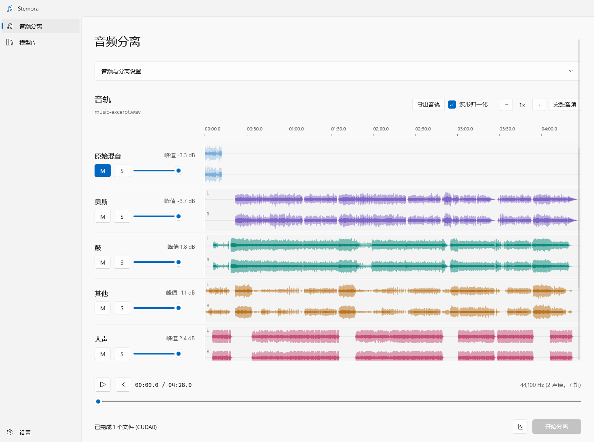
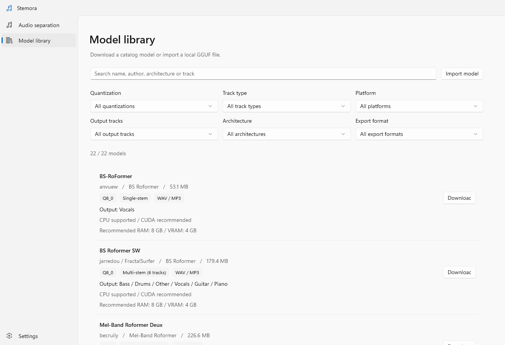
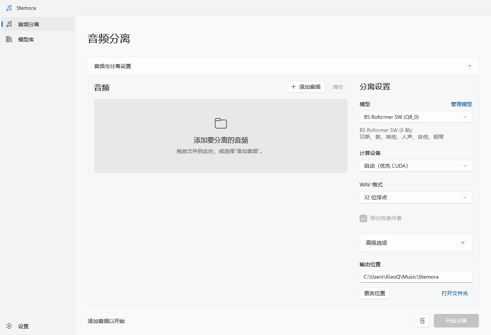

# Stemora

[简体中文](README.md) | [English](README.en.md)

**Split a song into separate tracks on Windows.** Vocals, drums, bass, guitar, piano, and everything else — all processed locally.

[](https://github.com/TaiRuiQu/Stemora/releases/latest)
[](#requirements)
[](LICENSE)

Stemora is a free, local audio separation and melody transcription tool for remixes, covers, sampling, mixing practice, and video production. Separation needs no Python environment; MuScriptor transcription automatically prepares an isolated local runtime. Audio stays on your computer, with no server component.

**[Download for Windows](https://github.com/TaiRuiQu/Stemora/releases/latest)** / [Quick start](#quick-start) / [FAQ](#faq)

The app supports English and Simplified Chinese.



## Features

- **Multi-stem separation**: use a six-stem model to get vocals, drums, bass, guitar, piano, and other instruments in one pass.
- **Melody transcription**: local MuScriptor inference, neural BPM and major/minor key analysis, and automatic note snapping to a beat grid. Includes a piano roll editor, sampled piano and synchronized vocal playback, loops, drafts and numbered notation PDF export. Official model access is required; see the [integration and usage guide](docs/MELODY-TRANSCRIPTION.md).
- **Runs locally**: your audio and results stay on your computer. The network is only used to download models.
- **Synchronized playback**: every track shares one timeline, with mute, solo, per-track volume, and waveform zoom.
- **Flexible export**: choose the tracks you need and export WAV or 320 kbps MP3.
- **Model library**: browse and download models in the app with resume and SHA-256 verification, or import a local GGUF model.
- **CUDA / CPU**: NVIDIA GPUs are used automatically when available; CPU fallback works without one.
- **Batch processing**: add several files at once and process them one by one.

The app supports English and Simplified Chinese. Choose a language in Settings, or follow the Windows display language; changes apply immediately and are saved.

The model library supports combined filters for quantization, output tracks, single-stem / multi-stem, platform, architecture and export format. Each entry shows outputs, CPU / CUDA support and recommended RAM/VRAM. Measurements and estimates are documented in the [local resource report](docs/MODEL-MEMORY.md).

The top-level `Stemora.App.exe` launches the app. Runtime dependencies live in `app`, with English and Simplified Chinese resources only. Keep the `app`, `native` and `cli` folders with the launcher.

## Requirements

| Item | Requirement |
| --- | --- |
| OS | Windows 10 version 2004 (build 19041) or later; Windows 11 |
| Architecture | x64 |
| GPU | Optional. NVIDIA GPUs can use CUDA; otherwise Stemora uses the CPU |
| Disk | About 1.1 GB unpacked; 30 MB–1 GB per separation model or 0.4–5.5 GB per transcription model; allow several more GB for the transcription runtime and results |
| Other | No administrator rights, Python, or separate .NET installation required |

> If Windows shows an "Unknown publisher" warning on first launch, confirm that the file came from this repository's Releases, then choose "More info" → "Run anyway".

## Download and install

1. Open [Releases](https://github.com/TaiRuiQu/Stemora/releases/latest) and download `Stemora-v*-windows-x64.zip`.
2. Extract it to a folder you can write to, such as `D:\Apps\Stemora`. Do not copy the exe by itself; keep the `native` and `cli` folders next to it.
3. Double-click `Stemora.App.exe`.

This is a portable build: there is nothing to install, and deleting the folder removes the app. Avoid `C:\Program Files`, because the app needs to save models and settings next to itself.

`SHA256SUMS.txt` on the release page contains the SHA-256 checksum of the archive.

## Quick start

### 1. Download a model

Stemora does not bundle models. Open **Model library** (**模型库**) from the sidebar, pick a model, and click **Download** (**下载**). If you try to start separation without a model, the app will point you there.

Start with **BS Roformer SW (Q8_0, about 180 MB)**, which produces six tracks. Once downloaded, the model works offline.



### 2. Add audio

Open **Audio separation** (**音频分离**), click **Add audio** (**添加音频**), or drag files into the window. You can add several files at once.

### 3. Adjust the separation settings

- **Model** (**模型**): choose a model; the tracks it produces are listed below the selector.
- **Compute device** (**计算设备**): leave it on **自动（优先 CUDA）** (Auto, prefer CUDA). Stemora falls back to the CPU when no NVIDIA GPU is available.
- **WAV format** (**WAV 格式**): 32-bit float preserves the original level; 24-bit and 16-bit PCM are more compatible.
- **Output location** (**输出位置**): each job creates its own folder here.



### 4. Start separation

Click **Start separation** (**开始分离**) in the bottom-right corner. Progress and logs appear at the bottom of the window. The first model load takes a little longer, and CPU separation is usually much slower than CUDA.

### 5. Listen and export

When separation finishes, all tracks appear on one timeline:

- Click or drag any waveform to seek; the progress bar at the bottom moves every track together.
- **M** mutes a track, **S** solos it. Several tracks can be soloed at once; mute takes priority over solo.
- Each track has its own volume. Muted tracks keep advancing in sync, so toggling them does not shift the audio.
- Use the mouse wheel to zoom a waveform, or click **Full audio** (**完整音频**) to see the whole song.
- **Normalize waveform** (**波形归一化**) only changes the display. It does not affect playback volume or exported files.

Click **Export tracks** (**导出音轨**), select the tracks you want, then choose WAV or MP3 and a destination. Mute, solo, and volume do not affect exports, and each export creates a new folder.

## Choosing a model

The model library contains several model families and quantization levels. If you are not sure which one to pick:

| Goal | Recommended |
| --- | --- |
| Separate a full band in one pass | **BS Roformer SW** (six stems) |
| Extract vocals or an instrumental | **BS-RoFormer** / **Mel-Band Roformer** vocal models |
| Lower disk and memory use | **Q4_0** / **Q5_0** versions of the same model |
| Highest quality | **Q8_0**, **FP16**, or **FP32** |

About quantization: `Q8_0` balances file size and quality. `Q4_0` uses smaller files but may lose more detail; `FP16` / `FP32` use larger files. Speed and peak memory also depend on kernels and chunk size. See the [local resource report](docs/MODEL-MEMORY.md).

Models in the library come from repositories such as [BSRoformer-GGUF](https://huggingface.co/chenmozhijin/BSRoformer-GGUF) and [BS-RoFormer-SW-6stem](https://huggingface.co/FractalSurfer/BS-RoFormer-SW-6stem); see each model card for the author and license.

Multi-stem output order is defined by the model. BS Roformer SW always produces:

| File | Track |
| --- | --- |
| `bass.wav` | Bass |
| `drums.wav` | Drums |
| `other.wav` | Other |
| `vocals.wav` | Vocals |
| `guitar.wav` | Guitar |
| `piano.wav` | Piano |

Single-stem models can enable **导出残差伴奏** (Export residual accompaniment) to produce an extra `residual.wav` (the original mix minus the model output). If a custom model has no track names, Stemora uses neutral names such as `stem_1` and `stem_2` instead of guessing the instrument order.

> Stemora supports GGUF models built on the BS Roformer and Mel-Band Roformer architectures. Arbitrary GGUF models are not guaranteed to work; prefer the versions in the model library.

## Supported formats

**Input**: WAV, MP3, FLAC, M4A, AAC, AIFF, WMA, MP4.

Compressed formats rely on the codecs included with Windows. Mono audio is converted to stereo and resampled to 44.1 kHz. Surround audio is not supported, and neither are files that exceed the 4 GB RIFF WAV limit.

**Output**:

- WAV: 32-bit float, 24-bit PCM, or 16-bit PCM.
- MP3: 320 kbps, 44.1 kHz, stereo (available when exporting tracks).

MP3 export fails on Windows N editions without the Media Feature Pack. Install it from "Settings → Apps → Optional features".

Each job folder contains the separated WAV files and a `result.json`. The JSON records the input, model, track paths, backend, and elapsed time, which makes it easy to consume from scripts or other programs.

## FAQ

**Is my audio uploaded anywhere?**<br>
No. Separation and transcription run entirely on your computer, and audio and results are written only to local disk. The network is used to download models and prepare the isolated transcription runtime and its dependencies.

**Can I use it without an NVIDIA GPU?**<br>
Yes. Set **计算设备** (Compute device) to **自动（优先 CUDA）** (Auto) or **仅 CPU** (CPU only). CPU separation works, but it takes longer.

**Why is the first separation slow?**<br>
The model has to be loaded the first time, and CPU inference itself is slower. Later jobs reuse the downloaded model.

**What happens if a model download is interrupted?**<br>
Click Download again to resume. Models are pinned to a specific revision and verified with SHA-256; a failed check triggers a new download.

**What if Hugging Face is not reachable?**<br>
Download the GGUF file elsewhere, then open **模型库** (Model library) and click **导入模型** (Import model) to select the local file. Make sure the file is complete and uses a supported architecture.

**Where are the results saved?**<br>
In the folder selected under **输出位置** (Output location), with one subfolder per job. Models and settings live in `data` next to the app by default; the **设置** (Settings) page shows the current data folder.

**I moved the app and my models are gone.**<br>
The portable build stores models in `data\models`. Move the whole app folder to keep models and settings; moving only the exe does not bring the data along.

**Stemora says it cannot find the inference engine.**<br>
Use the complete release archive and keep the `native` folder in the same relative location as `Stemora.App.exe`. If you build from source, see the [development guide](docs/DEVELOPMENT.en.md).

**Do Chinese paths work?**<br>
Yes. The app, model, and output paths can all contain non-ASCII characters.

**Can I use the output commercially?**<br>
The source code is MIT-licensed, but model weights have their own licenses. Some models may not allow commercial use, so check the model card first. Copyright in the separated audio still belongs to the rights holders of the original work.

## Command line (optional)

The release also includes a CLI for scripting and integration:

```powershell
$cli = '.\cli\stemora.exe'
& $cli models list
& $cli models download --id bs-roformer-sw-q8_0
& $cli separate --input 'D:\Music\song.mp3' --model '.\data\models\BS-RoFormer-SW-6stem-q8_0.gguf' --output 'D:\Stems' --device cuda
```

See the [CLI reference](docs/CLI.en.md) for all arguments, NDJSON output, and exit codes.

## Build from source

Building requires Windows x64, the .NET 10 SDK, Windows SDK 10.0.26100, CMake / Ninja, and the Visual Studio C++ toolchain.

```powershell
.\scripts\Build.ps1
.\scripts\Publish.ps1 -SkipNativeBuild -IncludeRuntime
```

The published app is written to `artifacts/Stemora`. See the [development guide](docs/DEVELOPMENT.en.md) for tests and project layout.

## Contributing

Issues and pull requests are welcome. When reporting a problem, include your Windows version, the model name, the compute device (CUDA / CPU), and the error from the log. Please do not upload copyrighted audio; a short excerpt that reproduces the issue is enough.

## Acknowledgements

Stemora's inference layer builds on [BSRoformer.cpp](https://github.com/chenmozhijin/BSRoformer.cpp), [GGML](https://github.com/ggml-org/ggml), and [NAudio](https://github.com/naudio/NAudio). Models come from their respective authors; see [third-party notices](THIRD-PARTY-NOTICES.md).

## License

The source code is available under the [MIT License](LICENSE). Third-party components and model weights have their own licenses; model weights are independent of the MIT-licensed inference engine. See [THIRD-PARTY-NOTICES.md](THIRD-PARTY-NOTICES.md) for details.
