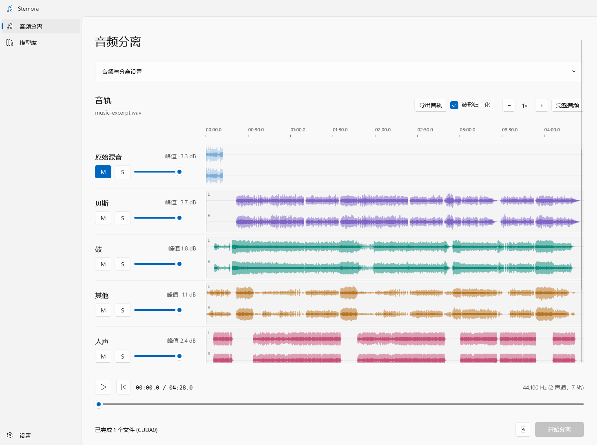
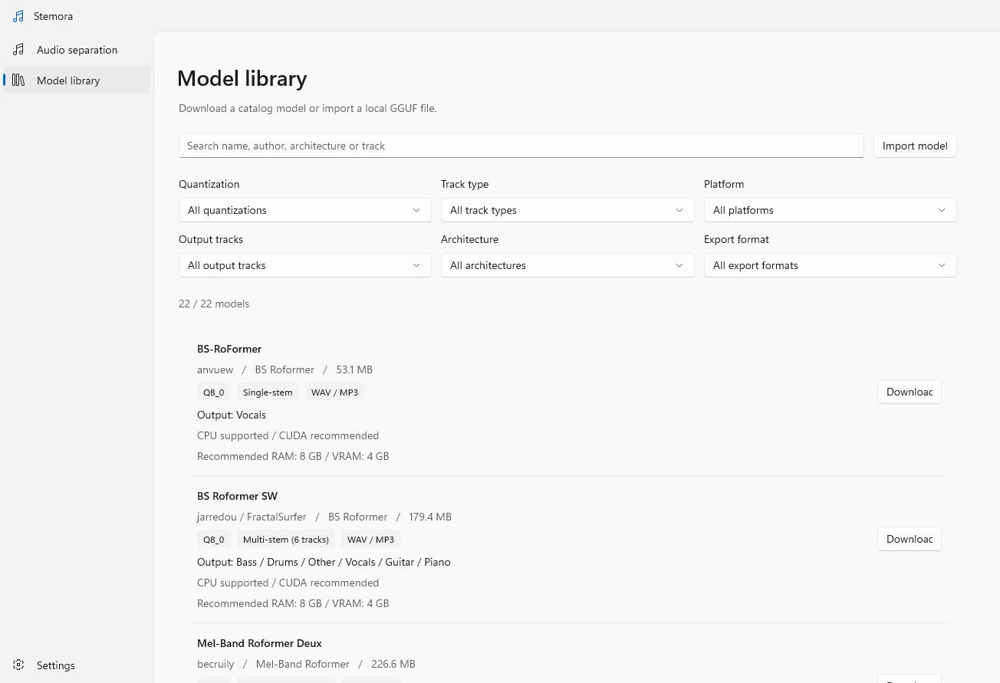
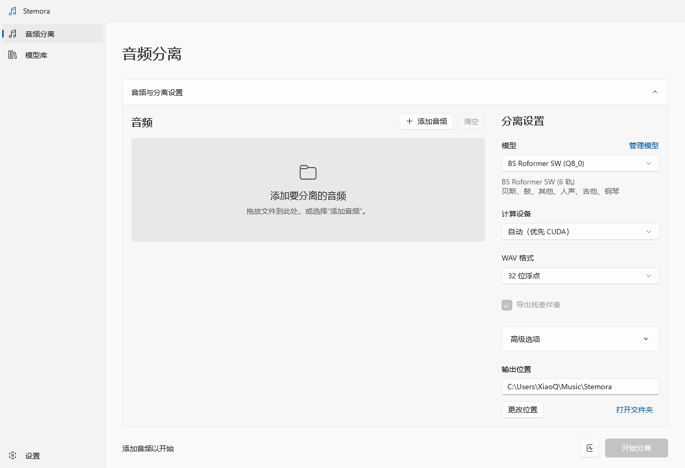

# Stemora

[简体中文](README.md) | [English](README.en.md)

**在 Windows 上把一首歌拆成独立音轨。** 人声、鼓、贝斯、吉他、钢琴、其他——全部在本机完成。

[](https://github.com/TaiRuiQu/Stemora/releases/latest)
[](#系统要求)
[](LICENSE)

Stemora 是一款免费的本地音频分离工具，适合 Remix、翻唱、采样、混音练习和视频制作。它不依赖 Python 环境，不上传音频，也不需要安装服务端。

**[下载最新版本](https://github.com/TaiRuiQu/Stemora/releases/latest)** / [快速上手](#快速上手) / [常见问题](#常见问题)



## 功能

- **多轨分离**：用六轨模型一次得到人声、鼓、贝斯、吉他、钢琴和其他乐器。
- **本地运行**：音频与结果只保存在电脑上；只有下载模型时需要联网。
- **同步试听**：所有音轨共用一条时间轴，支持静音、独听、独立音量和波形缩放。
- **灵活导出**：挑选需要的音轨，导出 WAV 或 320 kbps MP3。
- **模型库**：在应用内浏览和下载模型，支持断点续传与 SHA-256 校验，也可以导入本地 GGUF 模型。
- **CUDA / CPU**：有 NVIDIA 显卡时自动加速，没有也能用 CPU 完成分离。
- **批量处理**：可一次加入多个文件，任务逐个执行。
- **中英双语**：在设置中切换 English / 简体中文，或跟随系统，立即生效并保存。

## 系统要求

| 项目 | 要求 |
| --- | --- |
| 操作系统 | Windows 10 2004（内部版本 19041）或更高版本；Windows 11 |
| 架构 | x64 |
| 显卡 | 可选。NVIDIA 显卡可使用 CUDA 加速；其他情况使用 CPU |
| 磁盘 | 应用解压后约 250 MB；模型约 30 MB–1 GB；分离结果建议预留数 GB |
| 其他 | 无需管理员权限、无需 Python、无需单独安装 .NET |

> 如果首次运行时 Windows 显示“未知发布者”提示，请确认文件来自本仓库的 Releases，然后选择“更多信息 → 仍要运行”。

## 下载与安装

1. 打开 [Releases](https://github.com/TaiRuiQu/Stemora/releases/latest)，下载 `Stemora-v*-windows-x64.zip`。
2. 解压到任意有写入权限的目录，例如 `D:\Apps\Stemora`。不要只把 exe 单独复制出来，`native`、`cli` 等文件夹需要一起保留。
3. 双击 `Stemora.App.exe` 启动。

这是便携版：不需要安装，删除文件夹即可卸载。顶层的 `Stemora.App.exe` 是启动入口，运行依赖集中在 `app`，仅保留英文和简体中文资源；请保留 `app`、`native`、`cli` 文件夹。建议不要放在 `C:\Program Files`，因为程序需要在旁边保存模型和设置。

发布页的 `SHA256SUMS.txt` 提供了压缩包的 SHA-256，可用于校验下载。

## 快速上手

### 1. 下载一个模型

应用不附带模型。请先从左侧进入 **模型库**，选择模型并点击 **下载**；如果直接开始分离，应用也会提示你先选择模型。

推荐先下载 **BS Roformer SW（Q8_0，约 180 MB）**，它一次输出六条音轨。模型下载完成后即可离线使用。



### 2. 添加音频

进入 **音频分离**，点击 **添加音频**，或直接把文件拖进窗口。支持一次添加多个文件。

### 3. 调整分离设置

- **模型**：选择要使用的模型；下方会显示它输出的音轨。
- **计算设备**：保持“自动（优先 CUDA）”即可。没有 NVIDIA 显卡时会自动使用 CPU。
- **WAV 格式**：32 位浮点保留原始电平；24 / 16 位 PCM 兼容性更好。
- **输出位置**：每个任务会在这里创建独立文件夹。



### 4. 开始分离

点击右下角的 **开始分离**。进度和日志会显示在窗口底部。首次加载模型会稍慢；CPU 分离通常明显慢于 CUDA。

### 5. 试听与导出

分离完成后，所有音轨会出现在同一时间轴上：

- 点击或拖动波形可以定位；底部进度条对所有音轨生效。
- **M** 静音，**S** 独听。可以同时独听多条音轨，静音优先于独听。
- 每条音轨有独立音量；被静音的音轨仍会同步前进，切换时不会错位。
- 滚轮缩放波形，或使用 **完整音频** 查看全曲。
- “波形归一化”只影响显示，不改变试听音量和导出结果。

点击 **导出音轨**，勾选需要的音轨，选择 WAV 或 MP3 和保存位置。静音、独听和音量不会影响导出内容，每次导出会新建文件夹。

## 选择模型

模型库提供多个模型家族和量化版本。不知道选哪个时：

可以按量化类型、输出音轨、单轨/多轨、运行平台、模型架构和导出格式组合筛选。模型条目展示输出内容、CPU / CUDA 支持和建议内存、显存容量；实测结果与估算方法见[本机资源测试](docs/MODEL-MEMORY.md)。

| 需求 | 推荐 |
| --- | --- |
| 一次拆出完整乐队分轨 | **BS Roformer SW**（六轨） |
| 主要提取人声或伴奏 | **BS-RoFormer** / **Mel-Band Roformer** 人声模型 |
| 想减少模型文件体积 | 同模型的 **Q4_0** / **Q5_0** 版本 |
| 追求更高质量 | **Q8_0** 或 **FP16 / FP32** 版本 |

关于量化：`Q8_0` 通常在体积和效果之间比较均衡；`Q4_0` 文件更小，但可能有更多细节损失；`FP16` / `FP32` 文件更大。速度与峰值占用还取决于运行内核和分块，不能只按文件大小判断，详见[本机资源测试](docs/MODEL-MEMORY.md)。

模型库中的文件来自 [BSRoformer-GGUF](https://huggingface.co/chenmozhijin/BSRoformer-GGUF) 与 [BS-RoFormer-SW-6stem](https://huggingface.co/FractalSurfer/BS-RoFormer-SW-6stem) 等仓库，具体作者和许可证见各模型卡。

多轨模型的输出顺序由模型决定。BS Roformer SW 固定为：

| 文件 | 音轨 |
| --- | --- |
| `bass.wav` | 贝斯 |
| `drums.wav` | 鼓 |
| `other.wav` | 其他 |
| `vocals.wav` | 人声 |
| `guitar.wav` | 吉他 |
| `piano.wav` | 钢琴 |

单轨模型可以勾选“导出残差伴奏”，额外生成 `residual.wav`（原始混音减去模型输出）。如果自定义模型没有音轨名称信息，应用会使用 `stem_1`、`stem_2` 等中性名称，不会猜测乐器顺序。

> Stemora 只支持 BS Roformer、Mel-Band Roformer 架构的 GGUF 模型。任意 GGUF 模型不保证可以运行，建议优先使用模型库中的版本。

## 支持的格式

**输入**：WAV、MP3、FLAC、M4A、AAC、AIFF、WMA、MP4。

压缩格式依赖 Windows 自带的解码器。单声道会自动转为双声道并重采样到 44.1 kHz。不支持环绕声，以及超过 RIFF WAV 4 GB 限制的音频。

**输出**：

- WAV：32 位浮点、24 位 PCM、16 位 PCM。
- MP3：320 kbps、44.1 kHz、双声道（导出音轨时可用）。

Windows N 版本如果不带媒体功能包，MP3 导出会失败。可在“设置 → 应用 → 可选功能”中安装“媒体功能包”。

每个任务的结果文件夹包含分离后的 WAV 和 `result.json`。`result.json` 记录输入、模型、每轨路径、后端和耗时，方便脚本或其他程序读取。

## 常见问题

**音频会上传到服务器吗？**<br>
不会。分离全程在本机完成，音频和结果只写入本地磁盘。只有下载模型时会访问 Hugging Face。

**没有 NVIDIA 显卡可以用吗？**<br>
可以。把计算设备设为“自动”或“仅 CPU”。CPU 也能完成分离，只是耗时更长。

**为什么第一次分离很慢？**<br>
首次使用需要加载模型；如果使用 CPU，推理本身也会比较慢。后续任务会复用已下载的模型。

**模型下载中断了怎么办？**<br>
重新点击下载即可续传。模型下载固定版本并校验 SHA-256，校验失败会重新获取。

**无法访问 Hugging Face 怎么办？**<br>
可以在其他网络环境下载对应的 GGUF 文件，然后回到 **模型库** 点击 **导入模型** 选择本地文件。请确认文件完整，并且属于受支持的模型架构。

**结果保存在哪里？**<br>
在“输出位置”指定的目录中，每个任务一个子文件夹。模型和设置默认保存在程序目录的 `data` 下；“设置”页会显示当前数据目录。

**移动或重装后模型不见了？**<br>
便携版把模型保存在 `data\models`。移动整个程序文件夹即可保留模型和设置；只移动 exe 不会带走数据。

**应用提示“未找到推理引擎”怎么办？**<br>
请使用完整的发布包，并保持 `native` 文件夹与 `Stemora.App.exe` 的相对位置。自行构建时请参考[开发文档](docs/DEVELOPMENT.md)。

**支持中文路径吗？**<br>
支持。应用、模型和输出路径都可以包含中文。

**可以商用吗？**<br>
源代码使用 MIT 许可证，但模型权重有各自的许可证。部分模型可能不允许商用，请在使用前查看对应模型卡。分离结果的版权仍归原作品权利人所有。

## 命令行（可选）

发布包同时包含 CLI，适合批处理或接入其他程序：

```powershell
$cli = '.\cli\stemora.exe'
& $cli models list
& $cli models download --id bs-roformer-sw-q8_0
& $cli separate --input 'D:\Music\song.mp3' --model '.\data\models\BS-RoFormer-SW-6stem-q8_0.gguf' --output 'D:\Stems' --device cuda
```

完整参数、NDJSON 输出和退出码见[命令行参考](docs/CLI.md)。

## 从源码构建

构建需要 Windows x64、.NET 10 SDK、Windows SDK 10.0.26100、CMake / Ninja 和 Visual Studio C++ 工具链。

```powershell
.\scripts\Build.ps1
.\scripts\Publish.ps1 -SkipNativeBuild -IncludeRuntime
```

发布目录位于 `artifacts/Stemora`。详细说明、测试和项目结构见[开发文档](docs/DEVELOPMENT.md)。

## 贡献

欢迎提交 Issue 和 Pull Request。报告问题时，请附上 Windows 版本、模型名称、计算设备（CUDA / CPU）以及日志中的错误信息。请勿上传受版权保护的音频；可以使用一段能复现问题的短片段。

## 致谢

Stemora 的推理层建立在 [BSRoformer.cpp](https://github.com/chenmozhijin/BSRoformer.cpp)、[GGML](https://github.com/ggml-org/ggml) 和 [NAudio](https://github.com/naudio/NAudio) 之上。模型来自各自作者，详见[第三方说明](THIRD-PARTY-NOTICES.md)。

## 许可证

源代码采用 [MIT 许可证](LICENSE)。第三方组件和模型权重适用各自的许可证；模型权重与推理引擎的 MIT 许可证相互独立。详见 [THIRD-PARTY-NOTICES.md](THIRD-PARTY-NOTICES.md)。
