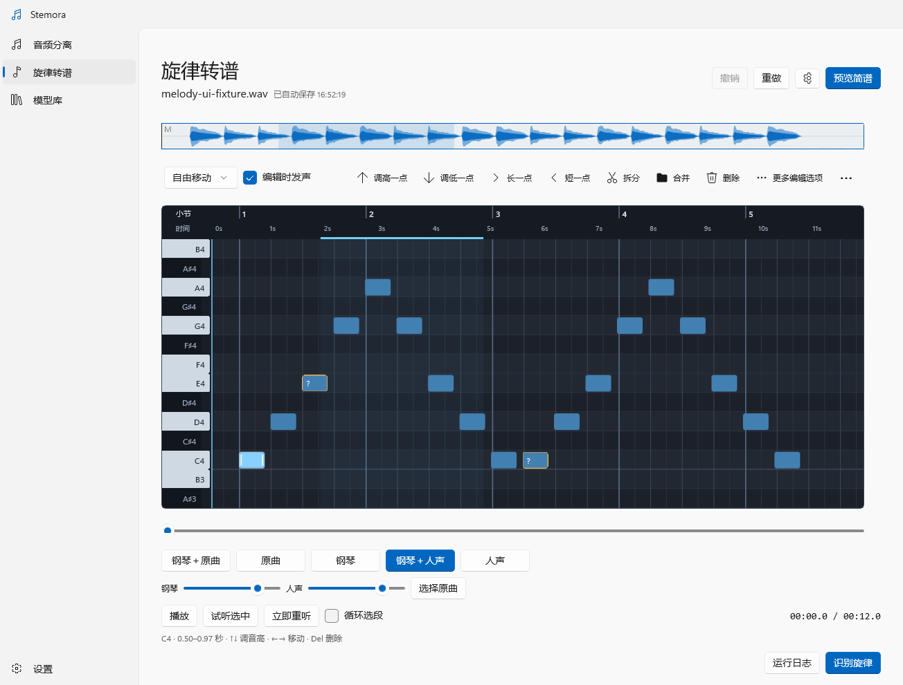

# MuScriptor 旋律转谱

依据 `MELODY-TRANSCRIPTION-UX.md` 实现的首版工作台。入口为「音频分离 / 旋律转谱 / 模型库 / 设置」。

## 使用

1. 打开「旋律转谱」，添加音频或拖放文件。默认整首，可勾选「只做一段」并设置原曲秒数；纯人声可勾选「这是纯人声」。
2. 在「模型库」将用途选为「旋律转谱」，即可查看 MuScriptor small / medium / large 的大小、文件格式、下载状态和授权说明。下载完成后点击「使用」返回转谱工作台。转谱页的「管理模型」直接进入该列表，已导入的音频保持不变。首次下载自动安装本地运行环境，无需手动配置 Python。
3. MuScriptor 官方权重为受限仓库。在模型库展开「MuScriptor 下载与授权」，选择计算设备，打开对应模型卡并接受许可；本机已有 Hugging Face 登录时自动复用，也可以填写本次下载专用的读取令牌。应用不会替用户接受许可，不把令牌写入设置、草稿或命令行。转谱页只保留模型与计算设备选择，统一复用模型库安装结果。
4. 混音会先通过现有分离引擎提取已知 `vocals`。已安装的人声分离模型优先，否则自动下载内置目录中的人声模型。分离页人声轨旁的「转成旋律」直接复用完整人声及原曲时间。未知轨需要用户试听确认。
5. 结果页以钢琴卷帘为主，顶部波形显示全曲、可见时间范围和循环范围。设置收进齿轮按钮，吸附、编辑试听和音符操作合并在卷帘上方的一行工具栏，窄窗口自动溢出到更多菜单。保存状态与文件名底部对齐，零散说明移除；试听切换与播放控制固定在底部。
6. 识别时自动使用神经网络分析 BPM、首拍和大小调，并将音符吸附到十六分音符网格。编辑后预览简谱，确认调性、每小节拍数、速度和首拍位置，再导出 PDF。节奏未确认时仍可导出标记为草稿的谱面。最简算法与接入见 [BPM、调性与自动吸附](MUSIC-ANALYSIS.md)。

MuScriptor 官方模型将歌声归入 `clarinet` 组；适配层对提取的人声使用此组约束。模型可能输出重叠音符，重叠与短音按具体原因标记待核对；这些标记不是模型置信度或全曲准确率。



上图为实际 WinUI 渲染，音符与音频为界面验证用合成素材，不代表模型识别效果。

## 编辑与试听

- 点击琴键或音符立即试听，拖动音高时随半音变化发声；可关闭「编辑时发声」。单击音符选择；Ctrl 单击多选，Shift 扩选；空白处拖动框选。
- 拖主体改音高或位置，按初始主要方向锁轴；Alt 拖动可同时修改。左右手柄修改起止，短音可用「放大选中」或精确起止输入。
- Del / Backspace 删除选中；↑ / ↓ 升降半音，Shift+↑ / ↓ 升降八度；← / → 移动到相邻吸附网格，Shift+← / → 缩短或延长到相邻网格，自由移动时步长为 0.05 秒。支持多选，遇邻音和音频边界停止。S 在播放线拆分单个音符，M 打开合并确认，F 放大选中；Ctrl+Z 撤销，Ctrl+Y / Ctrl+Shift+Z 重做，Ctrl+A 全选；Esc 取消拖动或清空选择。工具栏按钮显示对应快捷键提示。
- 旋律页内快捷键由窗口 PreviewKeyDown 接管，点击卷帘后自动取得键盘焦点，焦点在普通按钮上时仍可编辑。空格播放 / 暂停，长按空格不反复切换，方向键可连续编辑；输入框、数值编辑、下拉框、弹窗和音量滑块保留自身按键行为，侧栏导航保留方向键导航。
- 新识别结果依据神经网络 BPM 与首拍自动量化，默认开启 1/16 编辑吸附；可选择「自由移动」或 1/8，Alt 临时绕过吸附。旧草稿保持原音符时间。移动、延长遇邻音停止，不挤走邻音。
- 合并前显示范围与沿用音高；跨明显休止不合并。拆分优先使用播放线，否则从中点拆分。双击空白补音。
- 播放时自动跟随：播放线接近右侧时推进视口并同步横向滚动条；定位、循环回到前面时重新显示播放位置。选择或编辑音符不会关闭跟随，正在拖动时暂缓滚动，松开后继续。
- 普通滚轮移动音域，Shift+滚轮平移时间，Ctrl+滚轮围绕指针缩放；中键拖动平移。拖标尺设置循环范围。
- 卷帘顶部显示双行标尺：上行为小节号，下行为原曲秒数，小节线、拍线和细分网格使用不同强度。小节号与简谱共用首拍、BPM 和每小节拍数；弱起、缩放、平移后仍对应同一小节，缩得很小时自动减少标签密度。
- 试听模式为「钢琴＋原曲」「原曲」「钢琴」「钢琴＋人声」「人声」。导入混音后默认可直接播放原曲；从分离页进入时复用原曲和人声路径。直接导入纯人声的草稿可通过「选择原曲」关联同起点、同时长的完整混音，路径保存在草稿中，下次分析优先使用关联原曲。仅按时长检查，用户需确保来自同一版本且没有裁切或时间偏移。
- 原曲、人声和钢琴共用同一音频时钟，静音时也持续前进；播放中切换不中断位置，不会将分离人声与原曲重复叠加。钢琴与当前对照音频音量可独立调节，钢琴修改实时生效，支持选段、循环及自动跟随。
- 已移除原始音高试听和虚线参考。卷帘只显示编辑后的音符，不按修改前后区分音符颜色；已有草稿中的识别快照保留为内部数据，编辑仍支持撤销。
- 钢琴音色使用内置 Salamander Grand Piano 录音采样（Alexander Holm，CC BY 3.0），覆盖 A0–C8 的 30 个锚点，中间音高插值播放，含自然衰减和短释音；点击琴键、音符试听和播放使用同一音色，运行时不联网下载。采样包约 10 MB，出处与处理记录见 `licenses/Salamander-Grand-Piano.txt` 及 `src/Stemora.Core/Data/Piano/manifest.json`，可用 `python scripts/fetch-piano-samples.py` 重建（需要 ffmpeg）。
- 频谱显示及 FFT 计算已移除。人声音频保持原录音，编辑影响钢琴旋律与谱面。

## 本地数据与恢复

数据根目录遵循现有 `STEMORA_HOME` / 便携模式规则：

| 内容 | 相对位置 |
| --- | --- |
| 草稿 | `melodies/<ID>.stemora.json` |
| 模型 | `models/muscriptor/<small|medium|large>` |
| 节奏与调性权重 | `models/music-analysis/madmom_infer/models` |
| CPU / CUDA 独立环境 | `runtime/muscriptor-0.4.0-cpu` / `runtime/muscriptor-0.4.0-cu128` |
| 托管 Python 与安装缓存 | `runtime/python` / `runtime/uv-cache` |

草稿采用临时文件加原子替换，包含源音频 SHA-256、原曲起止、原始与编辑音符、稳定 ID、疑点、100 步撤销 / 重做、分析版本、循环、视口、排谱设置和当前阶段。「打开草稿」列出最近本地草稿，也可浏览外部草稿文件。

音频路径变化不影响音符编辑；重新定位必须匹配源内容摘要。移动便携数据后，失效的虚拟环境会在下次准备时重建，模型和草稿仍保留。

取消或识别失败保留已完成人声；重试复用人声。旧版草稿的频谱字段仍可读取，打开后清理；曾停在频谱阶段的草稿直接恢复为完成状态。重新识别已有编辑时另存草稿，可选择打开新版本；不会覆盖人工版。原始音频不被改写。

## 接入与版本

- 官方 Python 包：`muscriptor==0.4.0`，使用 `TranscriptionModel.load_model`、`transcribe`、`NoteEndEvent` 和 `ProgressEvent`。
- 后台子进程无控制台窗口，参数通过 `ArgumentList` 传递，进度为逐行 JSON。仅官方分块进度显示百分比，其余使用不定进度。取消终止整个子进程树。
- 首次环境准备分别展示安装工具、Python、MuScriptor / PyTorch 依赖和环境检查阶段，显示安装器实时消息与已用时；模型库可以直接展开安装日志。依赖安装期间不伪造百分比，失败与取消后保留消息以便重试。
- 自动安装使用 uv 0.13.1 Windows x64 归档，校验归档 SHA-256。Python 3.12 自动安装到应用数据目录。
- 权重下载固定 Hugging Face revision，大小与 SHA-256 来自官方模型仓库元数据，下载后复核。small 411,888,600 字节；medium 1,228,144,472 字节；large 5,465,642,136 字节。
- 代码许可证与权重许可证分开；MuScriptor 权重为 CC BY-NC 4.0。首次下载涉及运行环境及依赖，磁盘与网络需求大于单独的模型大小。
- 完成安装和下载后，推理强制使用本地权重、离线 Hugging Face 模式。音频不上传。

## 命令行

```powershell
dotnet run --project src/Stemora.Cli -c Release -- melody models --json
dotnet run --project src/Stemora.Cli -c Release -- melody prepare --model small --device cpu
dotnet run --project src/Stemora.Cli -c Release -- melody transcribe --input vocals.wav --model small --start 15 --end 45 --output ./scores --json
```

CLI 的 `melody transcribe` 输入为已提取的人声，输出本地草稿与标为节奏待确认的 PDF。混音自动提取由应用工作流完成。CLI 下载复用 `HF_TOKEN` 或 Hugging Face 本机登录，不通过命令行参数接收令牌。

通用 `models list` 也包含三个 MuScriptor 型号；`models download --id muscriptor-small --device cpu` 使用同一安装路径。分离模型选择器与 GGUF 检查只使用分离目录，不会将 MuScriptor 权重交给分离引擎。

## 验证与已知边界

```powershell
dotnet build Stemora.sln -c Release -p:Platform=x64
dotnet run --project tests/Stemora.Tests -c Release
uv run --with muscriptor==0.4.0 python -m unittest discover -s tests -p test_muscriptor_bridge.py -v
```

本次验证：.NET 完整构建、核心检查、已安装官方 0.4.0 的事件 / 下载 / 设备适配测试、自动安装 CPU 运行环境、实际 WinUI 渲染、真实音频设备时钟 / A-B 切换 / 循环，以及 PDF 渲染。

已验证本机 MuScriptor 0.4.0 / CUDA 环境与 small 官方权重校验，并使用真实识别保存的 1,094 音符草稿进行简谱预览回归。预览每页展示 8 小节，共用一个横向视口，避免长曲谱为每小节创建嵌套滚动区域引发布局循环；切页与反复切换编辑视图保留音符、选择和时间轴。此验证不作为旋律准确性评测。文中界面截图使用明确标注的合成音符与音频；官方包适配测试使用真实公开事件类型。

钢琴卷帘改版验证：Release 构建零警告 / 零错误、111 项核心检查通过；音频检查覆盖实时改音、撤销恢复、删除释放、钢琴 / 人声 / 混合同钟切换和选段终点。WinUI 诊断覆盖中英文、浅色 / 深色、紧凑窗口、真实设备播放与循环。Windows computer-use 的 native pipe 无法连接，因此鼠标拖动的人工式自动化检查未完成。窗口快捷键路由通过按钮、导航、滑块焦点、按键重复及输入框 / 弹窗避让的 WinUI 回归验证。

仅运行合成素材的编辑器与播放诊断可使用 `--capture-ui <目录> --capture-melody`。

快捷键、小节标尺与原曲试听增补验证：136 项核心检查通过；实际 WinUI 诊断覆盖按键焦点、连续方向键、Shift 八度 / 时值、吸附与自由微调、删除 / 撤销 / 重做、多选、拆分 / 放大、输入控件避让、不同拍号与平移标尺，以及真实音频设备播放时原曲 / 人声 / 钢琴模式切换。中英文与紧凑布局渲染已检查；诊断使用合成音频，不作为识别效果评测。

复现已保存草稿的预览回归（只写入隔离的诊断数据目录）：

```powershell
$env:STEMORA_HOME = 'G:\Stemora\.local\preview-regression-home'
.\src\Stemora.App\bin\x64\Release\net10.0-windows10.0.26100.0\win-x64\Stemora.App.exe --capture-ui 'G:\Stemora\.local\preview-regression' --capture-melody-draft '完整路径\draft.stemora.json'
```

BPM、首拍和大小调使用神经网络分析，默认固定 4/4 拍、单一 BPM、十六分音符网格；手动排谱仍支持 2–12 拍。自动吸附仅使用全、二分、四分、八分和十六分时值，不自动识别复杂拍号、三连音、附点或复调谱面。原始识别音符保留且可撤销吸附，未找到拍点时保留原时间。保调慢放、候选旋律建议与原始连续音高轨迹尚未加入。人声试听保留原录音时间，钢琴试听使用量化后的音符时间。

参考来源（核对于 2026-11-12）：

- https://github.com/muscriptor/muscriptor
- https://pypi.org/project/muscriptor/0.4.0/
- https://huggingface.co/MuScriptor/muscriptor-small
- https://huggingface.co/MuScriptor/muscriptor-medium
- https://huggingface.co/MuScriptor/muscriptor-large
- https://github.com/astral-sh/uv/releases/tag/0.13.1

点击崩溃回归：音符图层不接收指针命中，由稳定的卷帘容器捕获鼠标；重绘防止子元素集合重入，取消手势可重复调用。WinUI 诊断覆盖实际命中目标、辅助功能音符激活、连续重绘 / 取消、播放越界跟随、编辑后跟随及双向定位；诊断完成后没有新增崩溃日志。
